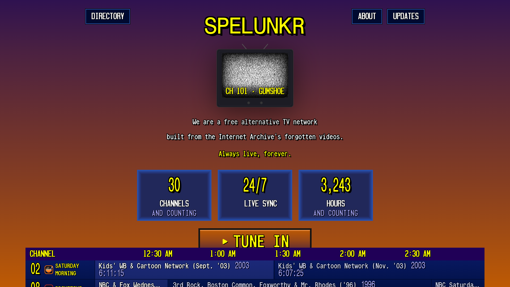
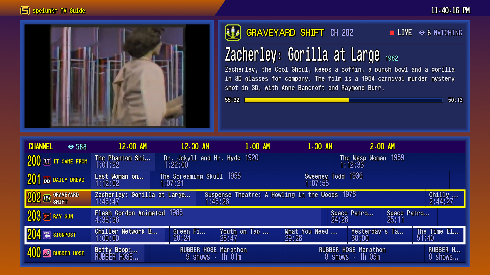
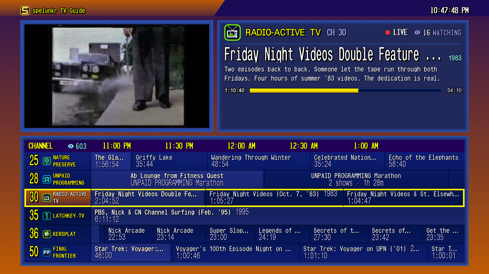
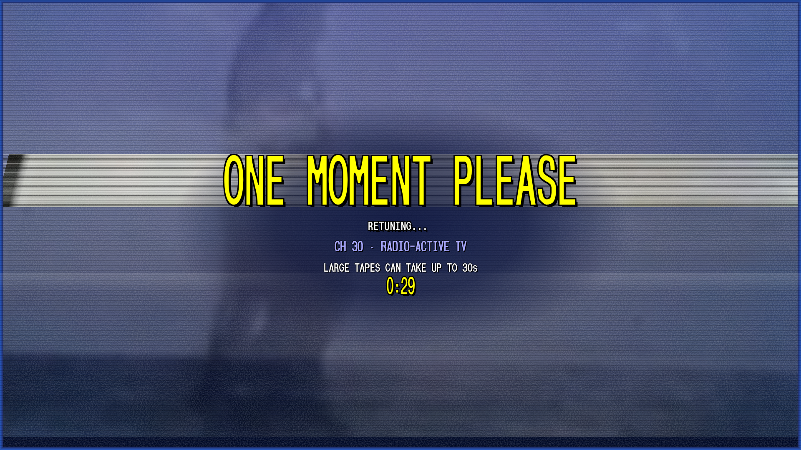
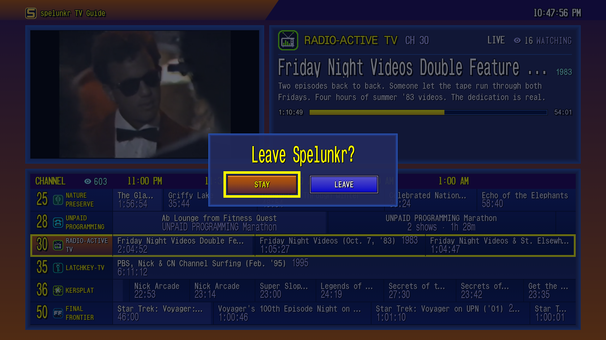
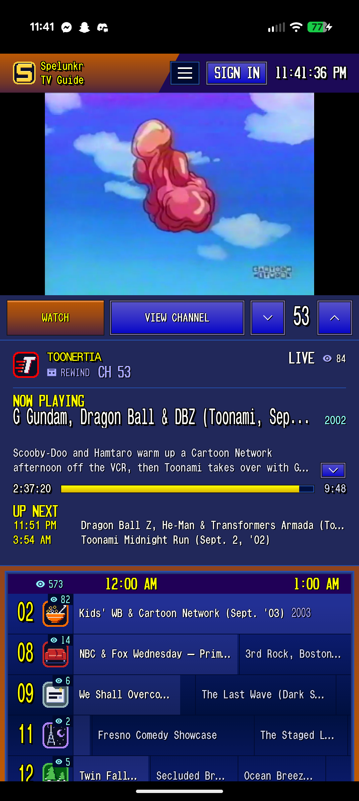
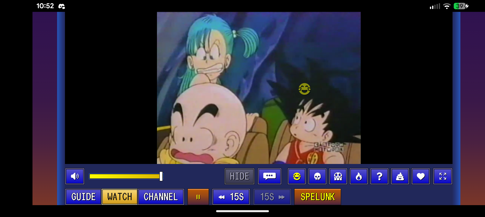
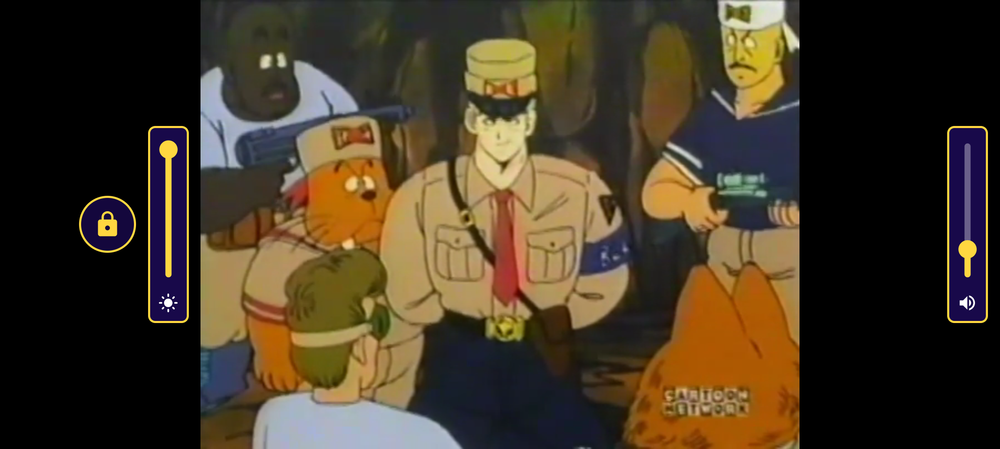

<div align="center">

```
 ███████╗██████╗ ███████╗██╗     ██╗   ██╗███╗   ██╗██╗  ██╗██████╗
 ██╔════╝██╔══██╗██╔════╝██║     ██║   ██║████╗  ██║██║ ██╔╝██╔══██╗
 ███████╗██████╔╝█████╗  ██║     ██║   ██║██╔██╗ ██║█████╔╝ ██████╔╝
 ╚════██║██╔═══╝ ██╔══╝  ██║     ██║   ██║██║╚██╗██║██╔═██╗ ██╔══██╗
 ███████║██║     ███████╗███████╗╚██████╔╝██║ ╚████║██║  ██╗██║  ██║
 ╚══════╝╚═╝     ╚══════╝╚══════╝ ╚═════╝ ╚═╝  ╚═══╝╚═╝  ╚═╝╚═╝  ╚═╝
          ~ ~ ~  F O R   A N D R O I D   &   A N D R O I D   T V  ~ ~ ~
```

### 📺 *Cable TV, but weirder. Now in your pocket AND on your couch.* 📼

*We are a free alternative TV network APP built from the Internet Archive's forgotten videos. Always live, forever.*

**▶ PLAY &nbsp;·&nbsp; ⏸ PAUSE &nbsp;·&nbsp; 📡 CH ▲▼ &nbsp;·&nbsp; ⏏ EJECT YOUR BOREDOM**

</div>

---

## 🕹️ WHAT IS THIS, DUDE?

Remember flipping channels at 2 AM and landing on a monster movie, a 1983 music-video block, or somebody's taped Saturday-morning cartoons *with the commercials still in*? **[spelunkr.tv](https://spelunkr.tv)** brought that back: 24/7 synchronized channels of forgotten Internet Archive video. You don't pick what plays. You tune in, and whatever's on is on, for everybody, at the same second.

This repo is the **totally tubular Android app** for it. One APK, two vibes:

- 📱 **Phones & tablets**: touch, fullscreen, picture-in-picture, and a screen lock so your thumb can't flip the channel mid-Toonami.
- 📺 **Android TV**: the site's own TV mode, driven entirely by the remote. Kick back, grab the Surge, and surf.

---

## 📸 SCREENSHOTS — *BE KIND, REWIND*

### 📺 On the big screen

| 🏠 Tune in | 📋 The guide |
|:---:|:---:|
|  |  |
| **📼 Friday Night Videos, summer of '83** | **📡 One moment please… tuning** |
|  |  |

| **💾 Now playing: Commodore 64 Training Tape, 1982** | **🚪 Back from the guide: STAY, MAIN MENU, or EXIT** |
|:---:|:---:|
|  |  |

### 📱 In your pocket

| 🗓️ Portrait guide | 🎬 Landscape player | 🔒 Locked, with brightness & volume |
|:---:|:---:|:---:|
|  |  |  |

---

## ⚡ FEATURES THAT ARE *ALL THAT AND A BAG OF CHIPS*

### 📺 Android TV
- 🎮 **Remote-first.** D-pad and OK drive the site's own TV navigation. Channel ▲▼, page ▲▼, next/previous and the media keys go straight to the page. Number keys dial channels.
- 🏁 **Main menu, ready to roll.** The start page fits above the guide strip, desktop-style, with the "FREE. THAT'S THE WHOLE OFFER." card on the right. **TUNE IN** is highlighted in a fat yellow border the second you land. ▲ goes to the top links, ◀ ▶ walk DIRECTORY · ABOUT · UPDATES, and ▼ snaps back to TUNE IN.
- 🏠 **On your TV's home screen.** A **SPELUNKR** row of every channel, with its pixel-art logo and favorites first. Pick a card and the app opens tuned straight to that channel.
- ⭐ **Favorites.** **Hold OK** on a channel in the guide to star it (hold again to unstar). Starred channels float to the top of the guide and the home-screen row.
- ⇄ **Flip back.** The app remembers your last two channels: there's a **⇄ LAST** button in the player bar, and the remote's LAST key works too. It also reopens on whatever you were last watching.
- 👀 **Look before you leap.** In the guide, ▲▼ move a white highlight without changing what's playing. Press **Select** to tune, **Back** to drop the highlight.
- 🚪 **Your call.** Back from the guide asks "Leave Spelunkr?": **STAY**, **MAIN MENU** (back to the TUNE IN page) or **EXIT** (closes the app). STAY is focused by default, so a stray press won't kick you out.
- 🧈 **Smooth.** Nothing is drawn behind the page, phone-only overlays are removed on TV, and the web renderer gets priority. On a 2 GB TV dongle, video plays at its full 30 fps with **zero dropped frames**.

### 📱 Phones
- ⭐ **Favorites.** Press and hold a channel in the guide to star it; favorites float to the top.
- ⇄ **Flip back.** A **⇄ LAST** button in the player jumps to the channel you were just on.
- 🔊 **Cranked to the max.** The player's own volume and its slider are pinned to full, so your device volume is the only knob. Mute still works.
- 🖥️ **Native fullscreen**, edge to edge, locked to landscape.
- 🪟 **Picture-in-picture.** Hit Home during fullscreen and the channel keeps playing in a little window.
- 👆 **Swipe to surf (fullscreen only).** In portrait, swipes are ignored so the on-screen channel buttons just work.
- 🔒 **Screen lock (fullscreen only).** Tap to show the lock, tap the lock, and stray touches can't reach the page. Touch again for the lock plus little **brightness** and **volume** sliders. Brightness only changes inside the app.

### 🌐 Everywhere
- ⏮️ **Back** gives the page the press first (closes the guide, panels, dialogs). Then it goes back a page, then "press back again to exit".
- 📶 **NO SIGNAL** screen with Retry, which also retries by itself when the network returns.
- ♻️ If the web renderer crashes, it's rebuilt without closing the app.
- 🔗 spelunkr.tv links (channels, clips, sign-in emails) open right in the app. Discord sign-in stays in the app, and other sites open in your browser.

---

## 🛠️ BUILD IT — *GAG ME WITH A COMPILER*

```bash
./gradlew assembleDebug     # app/build/outputs/apk/debug/app-debug.apk
./gradlew assembleRelease   # app/build/outputs/apk/release/app-release.apk (minified, signed)
./gradlew bundleRelease     # app/build/outputs/bundle/release/app-release.aab (upload this to Google Play)
```

🔑 **Signing.** Release builds are signed with the upload key named in `keystore.properties` at the project root. That file is git-ignored, and the keystore itself lives outside the repo:

```properties
storeFile=C:/path/to/spelunkr-upload.jks
storePassword=…
keyAlias=upload
keyPassword=…
```

Without that file, release builds fall back to the debug key, so anyone can still build. Google Play signs what users download (Play App Signing); this key only signs uploads.

## 💾 INSTALL IT — *INSERT CARTRIDGE, BLOW ON IT, TRY AGAIN*

```bash
adb install -r app/build/outputs/apk/release/app-release.apk
```

---

## 🙌 SHOUTOUTS — *THE MOST EXCELLENT DUDES & DUDETTES*

> 📼 **To the one-person crew behind [spelunkr.tv](https://spelunkr.tv)**: you built a whole TV network out of forgotten tapes, a working TV guide, and late-night channels that feel like 1994 at 2 AM. You didn't invent cable TV, but you brought it back from the dead. Respect. 🫡 This app is only a remote control for your station.

> 🕹️ **To OOZI**: the mastermind who wanted Spelunkr on every screen in the house and pushed these apps until they were **butter-smooth**. Phone, tablet, TV, all of it. Way past cool. 😎

> 🏛️ **To the [Internet Archive](https://archive.org)** and everybody who ever sat by a VCR, pressed record, and years later thought to upload the tape. Every channel exists because of you. [Give them something.](https://archive.org/donate)

---

## 📜 LICENSE

[GNU Affero General Public License v3.0](LICENSE). Share it, remix it, keep it free. 📼

---

<div align="center">

```
┌──────────────────────────────────────────────┐
│  THIS APP IS NOT AFFILIATED WITH OR ENDORSED │
│  BY SPELUNKR.TV OR THE INTERNET ARCHIVE.     │
│     ALL PROGRAMMING COURTESY OF THE ARCHIVE. │
└──────────────────────────────────────────────┘
```

**📺 STAY TUNED. 📺**

</div>
